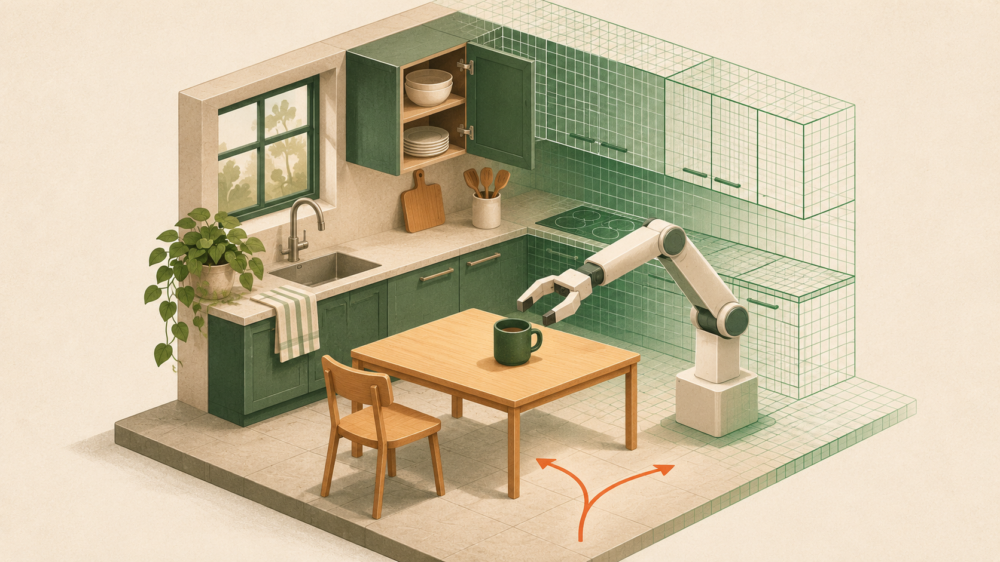
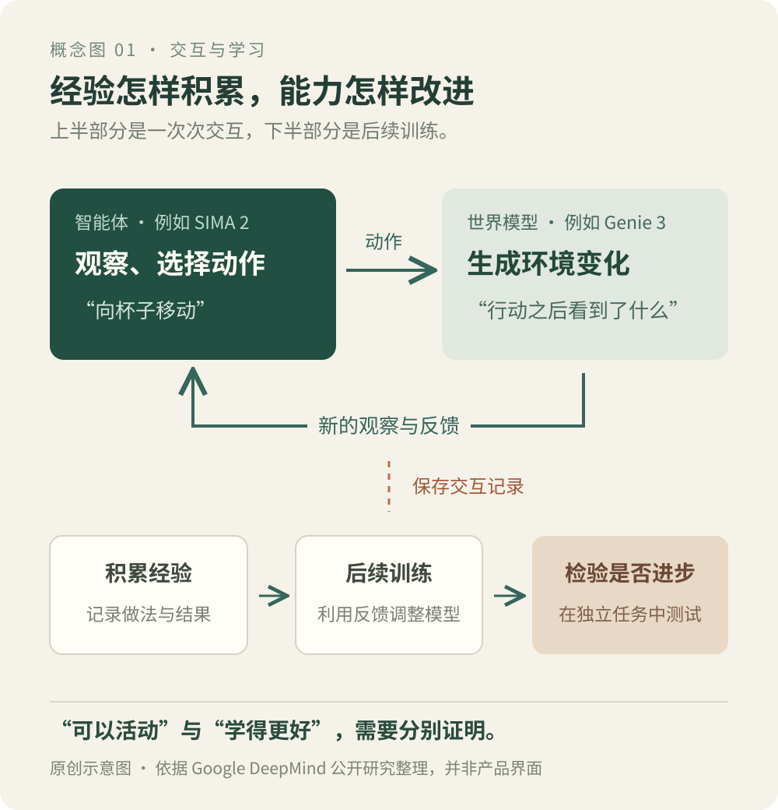
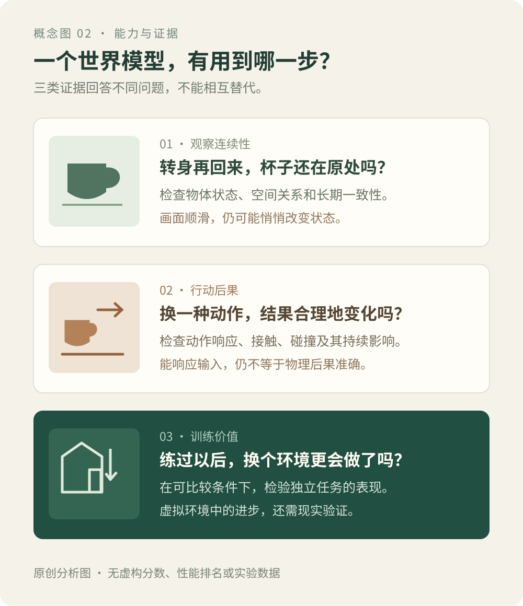

# Google 为什么要给 AI 一个可以行动的世界？

*从 Genie 到智能体，Google 想补上 AI 学习中的哪一块。*

封面：AI 生成的概念插画，不是 Google 产品截图或机器人实验实拍。

教一个 AI 收拾厨房，看视频只是开始。

视频里，一个人打开柜门，把杯子放进去。AI 可以认出杯子，也可以复述动作。但轮到它自己动手，问题马上多了起来：柜门向哪边开？伸手会不会碰倒旁边的碗？杯子放到一半，被人拿走了怎么办？

我们在生活中积累的许多经验，都来自这些具体的小麻烦。

2026 年 10 月 27 日，Google DeepMind 公布 Genie 4。按照官方介绍，它可以生成随操作变化的环境，并加入原生声音和实时场景修改；发布时先向受邀测试者提供研究预览。[Genie 4 发布说明](https://deepmind.google/blog/genie-4-a-new-generation-of-world-simulation/)

这些能力带来了一个更值得追问的问题：Google 为什么要花力气，让 AI 拥有一个可以进去活动的世界？

**沿着 Google 已公开的研究看，它想补充一种训练资源：能让 AI 反复尝试、看到后果，再调整行动的经验。**

这个世界可以供人探索，也可能成为 AI 的练习场。后者能否成立，要看里面的经验究竟有多可靠。

**01　从“看别人做”，到“试着自己做”**

一段做饭视频能告诉你，别人如何完成一道菜。它通常不会告诉你，如果晚关火十秒、少倒一点油，会出现哪些不同结果。

同样，AI 从视频中可以学习物体、动作和变化规律，但一段已经录好的视频，只记录了实际发生的那条过程。研究者想让 AI 比较不同做法，就需要一种能随行动给出反馈的环境。

这里可以把世界模型理解为：**根据眼前的情况，以及你准备采取的行动，推演接下来可能发生什么。** 这是 Google 的交互式世界模型特别关注的能力。[Genie 3 研究介绍](https://deepmind.google/blog/genie-3-a-new-frontier-for-world-models/)

用厨房作例子：杯子在桌沿，手向前推了一下。模型需要推演杯子的位置怎样改变、是否会掉下去。换一种力度或方向，后果也应相应变化。

画面只是结果的呈现方式。关键在于，行动能不能改变接下来发生的事，而且这种改变是否合理。

熟悉游戏的人会发现，这件事听起来很像游戏引擎。游戏和传统仿真环境早已可以供 AI 练习，程序化生成也能制造场景变化。Genie 系列尝试进一步用学习到的模型生成环境：通过文字或图像设定场景，再根据用户的操作持续生成后续画面。Project Genie 已经把这种方式做成了可供用户探索的原型产品。[Project Genie 产品介绍](https://blog.google/innovation-and-ai/models-and-research/google-deepmind/project-genie/)

设想研究者需要一百种厨房：柜子高度不同，通道宽窄不同，光线也不同。如果生成模型能够可靠地提供这些变化，搭建练习环境的方式就有机会改变。

这个“如果”很重要。场景容易生成，不代表它已经适合训练。

**02　世界会回应，还要有 AI 真正在里面做事**

有了虚拟厨房，仍然要回答：谁去收拾？

这就轮到**智能体**了。可以把它理解为一个带着目标做事的 AI 系统：观察环境，选择动作，查看结果，再决定下一步。

世界模型与智能体的分工，在 Google 的一组实验中很清楚。

2025 年 11 月，Google 发布 SIMA 2 的研究介绍。这个智能体把 Gemini 的能力用于理解目标和决定行动。研究团队还让它进入 Genie 3 生成的新环境，展示它根据指令采取行动；在后续训练中，团队也尝试使用智能体自己积累的交互经验来改进表现。[SIMA 2 研究介绍](https://deepmind.google/blog/sima-2-an-agent-that-plays-reasons-and-learns-with-you-in-virtual-3d-worlds/)

放到一起看，就是这样一个过程：

图 1｜原创示意图，依据 Google DeepMind 的公开研究整理。

这叫**闭环**：前一步的结果，会影响后一步的选择。

闭环本身还不等于学习。让 AI 在环境中活动，是收集经验；利用这些经验继续训练，才可能让它下次做得更好。

这也是 SIMA 2 与 Genie 组合值得关注的地方。研究开始把“生成一个环境”和“让 AI 在其中练习”连接起来。当然，虚拟环境中的表现，还需要经过现实任务的检验，才能说明对机器人有多大帮助。

**03　Google 想改变的，是练习的成本和供给**

现实中的机器人练习，往往要花钱、花时间，还要有人善后。

一次抓取失败，可能意味着杯子碎了；任务完成后，要把物品放回原位；换一个房间，又得重新安排设备和采集条件。机器人需要练习的偏偏是那些不整齐、不标准的情况。

传统模拟器已经缓解了这些问题。生成式世界模型进一步提出了一种可能：能否更方便地制造环境变化，让 AI 遇到更多情况？

这里的价值至少包括两件事。

一件是练习。学会在某间厨房里找杯子，还需要换一个布局继续试。另一件是考试。同一个目标，换一处遮挡、一个障碍物，观察 AI 从哪里开始失误。

但用于考试的环境本身也必须可靠。否则，研究者很难分清，失败来自智能体，还是来自模拟世界突然改了规则。

**我的判断是，Google 在争取的是持续生产、使用和检验交互经验的能力。** Genie 提供环境，SIMA 这样的智能体在其中行动，Gemini 的理解和推理能力参与其中。这些研究有机会相互促进，但仍有不少环节需要验证。

同时，Google 也在寻找更近的产品用途。

2026 年 1 月，Project Genie 开始向美国的成年 Google AI Ultra 订阅用户开放。到 Genie 4 的发布介绍里，官方列出的测试方向已经包括影视构思、互动体验原型和场景模拟。[Project Genie 上线说明](https://blog.google/innovation-and-ai/models-and-research/google-deepmind/project-genie/)、[Genie 4 测试用途](https://deepmind.google/blog/genie-4-a-new-generation-of-world-simulation/)

这些用途对准确性的要求并不一样。导演试一个镜头，可以接受部分细节稍后调整；机器人如果要依靠模拟学习抓取，就需要认真对待接触、碰撞和物体状态。

从这些公开安排看，创作工具可以先提供使用反馈，训练环境则承担更长远的研究目标。这条路径能否走通，还要看用户愿意怎样使用它，以及训练效果能否持续改善。

最终要算的账也很具体：**花同样的钱和时间，AI 能多获得多少真正有用的练习？** 生成画面的计算成本、错误样本的筛选成本，以及最后回到现实验证的成本，都要算进去。

**04　练习场最怕的，是悄悄改了规则**

想象一个学员在模拟厨房里练习。

他把杯子放进柜子，转身去拿盘子，再回头时，杯子变了位置。或者手还没碰到杯子，杯子就自己移动了。

画面也许依然顺滑，练习却出了问题。学员无法判断，是自己的动作造成了变化，还是环境临时编出了一种结果。

世界模型面临的难题，就藏在这些日常细节里。

物体离开视线后，要保留原有状态；动作造成的影响，需要持续存在；前面产生的小误差，也不能在不断生成后续画面的过程中越积越大。Google 在 Genie 4 的官方说明里仍列出了物体持续性、复杂物理交互和长期一致性等限制。[Genie 4 能力边界](https://deepmind.google/blog/genie-4-a-new-generation-of-world-simulation/)

还有一种更隐蔽的风险：AI 学会利用模拟环境的漏洞。假如虚拟杯子可以穿过柜门，它就可能学到一个在现实里根本行不通的捷径。

因此，**一段逼真的演示，能够证明视觉生成的进步；训练价值还要看它能否帮助 AI 在新任务中做得更好。**

图 2｜原创分析图。三类证据回答不同问题，不能相互替代。

这也解释了，为什么世界模型有不同的技术路线。

以 Meta 的 V-JEPA 2 为例，它在压缩后的内部表示中学习预测，而不要求把预测结果还原成完整画面。这种内部表示叫**潜在表征**，可以暂时理解为模型自己整理的一份“场景笔记”。研究团队又用机器人交互数据训练了动作条件版本 V-JEPA 2-AC，并在两处实验室的机械臂抓取、放置任务中进行了验证。[V-JEPA 2 论文](https://arxiv.org/abs/2506.09985)

“场景笔记”只是比喻，它并不是一张人类能直接读懂的清单。这条路线也不能保证自动保留所有有用信息。

它提出的取舍很实际：为了决定下一步怎么做，是否需要生成每一处视觉细节？而如果省去了细节，会不会恰好漏掉影响动作成败的那一点？

这些路线可以组合使用。评价时，需要回到各自要完成的任务，不能只凭画面决定优劣。

**05　人在世界里做过什么，是另一种重要的经验**

把目光从虚拟环境移回现实，银河水滴提出的人本世界模型，提供了另一个观察角度。

在 2026 年 9 月的公众号文章中，银河水滴将研究方向放在“人与世界的交互”上，希望从第三视角视频中学习人的行为及其后果，并提出利用步态识别的身份关联能力，把分散的行为片段联系起来。[银河水滴公众号原文](https://mp.weixin.qq.com/s/j7GkadDKq7AIibdW_OSSCg)

仍以厨房为例。一段视频记录开柜门，另一段记录取出杯子，后面又出现倒水、递给他人的动作。如果这些片段能够被正确关联，研究者就有机会获得更完整的行为线索。

但关联到同一个人，还不能直接解释他的目的。镜头也未必拍到手部细节、物体接触，或者画面之外发生的变化。如何从这些不完整的观察中学到可靠规律，是需要继续验证的部分。

Google 的 Genie 4 同样强调人物行为与环境响应。结合双方公开材料，更有意义的比较是：Google 的这组工作突出如何生成可交互的环境、让智能体在其中活动；银河水滴的公开构想，则突出如何利用真实的人类行为视频及其关联信息。这些材料不足以判断两者的完整架构，更不能直接排出技术高下。

它们可以引出一个共同的研究问题：**人类已经积累的行为经验，怎样变成 AI 可以理解、预测，并最终用于行动的能力？**

对这类研究，一个值得检验的方向是：真实视频能否帮助校正模型对人类行为的预测，生成环境能否补充现实中难以反复采集的变化。两者如何结合，要靠数据质量和任务结果回答。

回到开头的厨房。我们期待 AI 学会的，是在柜门位置改变、杯子被移动、有人走进来之后，仍然能够完成任务。

Google 给 AI 搭建的世界，已经可以让人走进去。接下来值得追踪的是：**AI 从里面学到的经验，究竟能带到外面多少。**

*资料核对截至 2026 年 11 月 2 日。本文基于公开研究、产品说明与公司文章；厨房场景用于解释概念，不是所述模型已经完成该任务的实测记录。*

---

**作品说明**：公开资料研究与评论；配图用于解释概念。封面由 AI 辅助生成，两张信息图按文中论证制作。文章与图示均不代表相关公司的官方立场。
